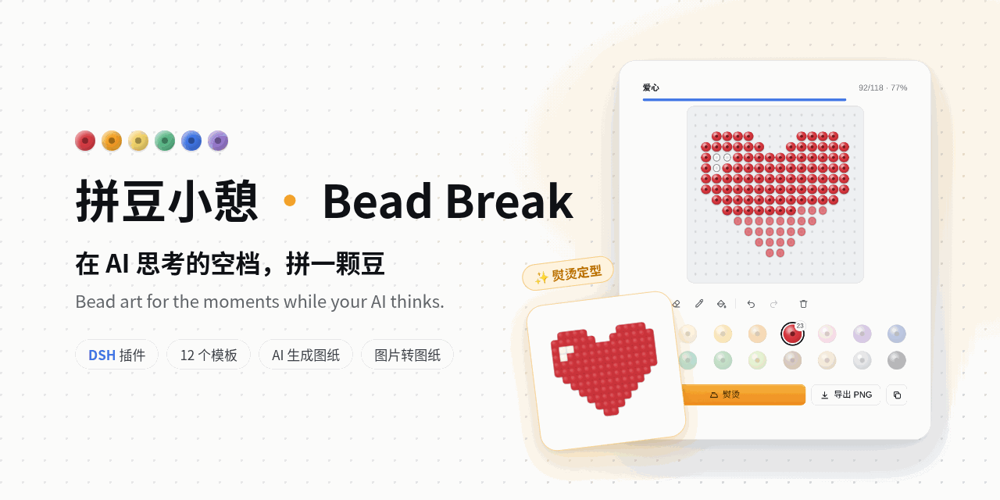
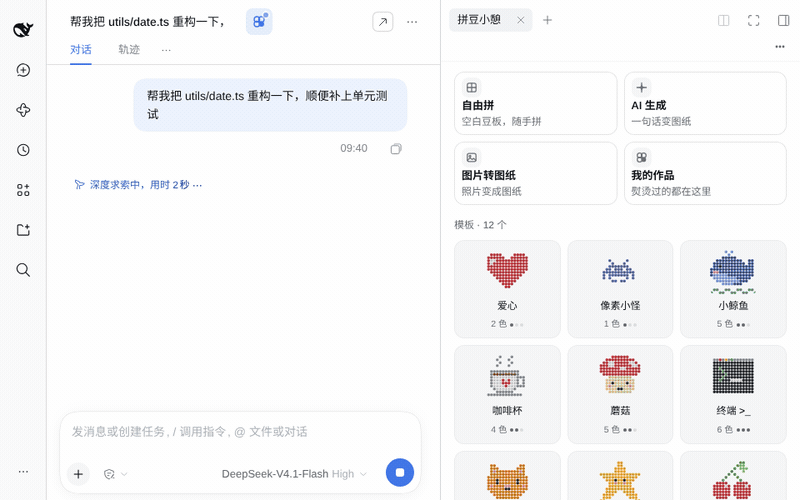
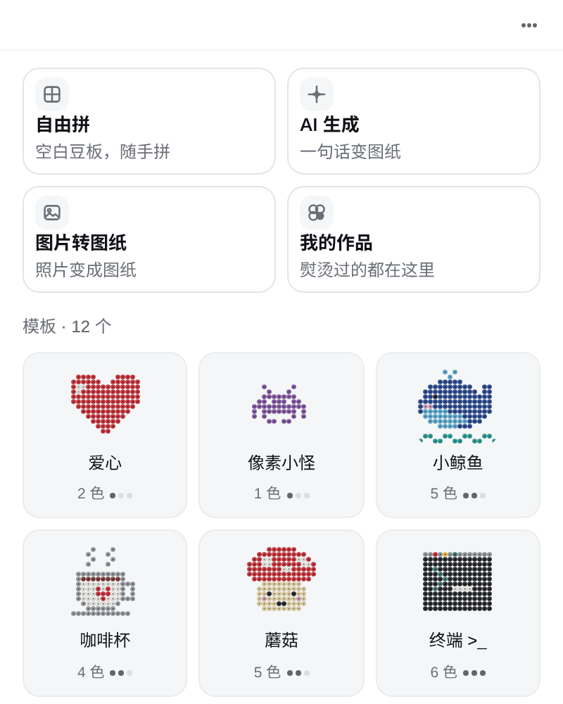
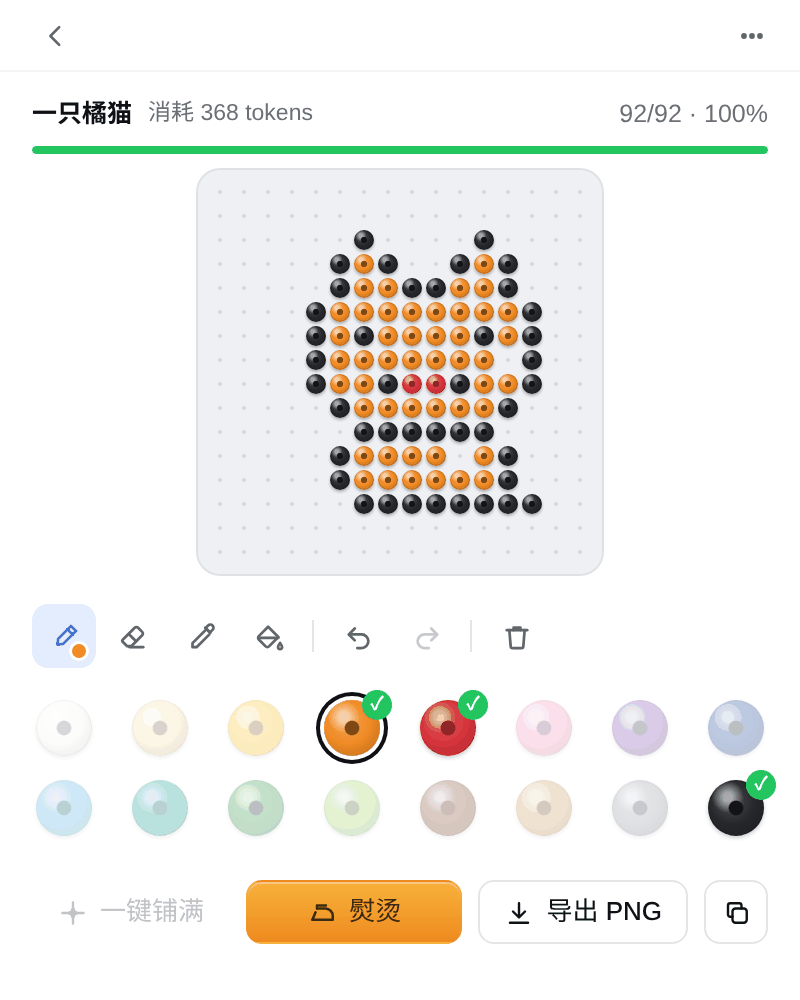
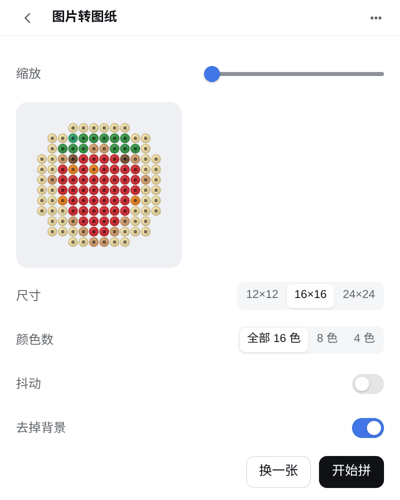
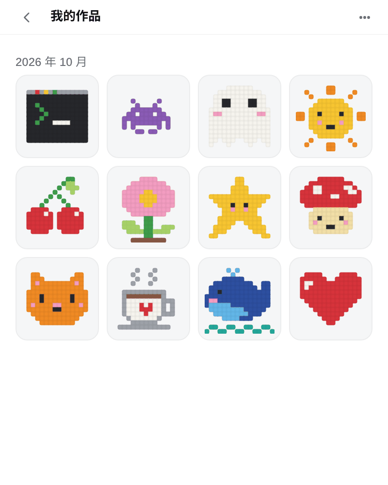

<h1 align="center">
  <picture>
    <source media="(prefers-color-scheme: dark)" srcset="docs/assets/readme-banner-dark.png">
    
  </picture>
</h1>

<div align="center">

<p>A perler-bead mini game in the DSH sidebar: 12 templates, AI patterns and picture to pattern, then iron your piece onto the works wall.</p>

<p>
  <a href="https://github.com/Teloi/dsh-pindou/actions/workflows/ci.yml"></a>
  <a href="./CHANGELOG.md"></a>
  <a href="https://github.com/deepseek-ai/deepseek-harness"></a>
  <a href="./LICENSE"></a>
  <a href="https://github.com/ukinch605/awesome-dsh-hub"></a>
</p>

<p><a href="./README.md">中文</a> · <strong>English</strong></p>

</div>

<br>

<p align="center">
  <picture>
    <source media="(prefers-color-scheme: dark)" srcset="docs/assets/readme-demo-dark.gif">
    <source media="(prefers-color-scheme: light)" srcset="docs/assets/readme-demo-light.gif">
    
  </picture>
</p>

<br>

Bead Break is a plugin for the Web shell of [DeepSeek Harness (DSH)](https://github.com/deepseek-ai/deepseek-harness). It opens a pixel perler-bead board in the right sidebar: follow a template, draw freely, or describe a picture in one sentence and let the model draw the pattern. Iron it when you're done and save it as a PNG.

## Features

- **There when the model is busy**: the bead button in the session header, or the small pill that appears above the composer after the model has been running for 3 seconds.
- **12 templates**: faint guide beads and a completion meter; iron the finished piece for a small confetti burst.
- **AI patterns**: one sentence → one model call → the pattern lands on the board, with the tokens it used.
- **Picture to pattern**: drop or paste a picture, crop it, pick the size and number of colors; it is converted on this device.
- **My works**: every ironed piece goes onto the wall; export it as PNG, copy it, or bead it again.
- **Follows DSH**: Chinese and English UI, light and dark theme, keyboard and screen reader support.

## Screenshots

<table>
  <tr>
    <td width="50%" align="center">
      <picture>
        <source media="(prefers-color-scheme: dark)" srcset="docs/assets/screens/screen-home-dark.png">
        
      </picture>
      <br><sub>Home and the 12 templates</sub>
    </td>
    <td width="50%" align="center">
      <picture>
        <source media="(prefers-color-scheme: dark)" srcset="docs/assets/screens/screen-ai-dark.png">
        
      </picture>
      <br><sub>A pattern from one sentence</sub>
    </td>
  </tr>
  <tr>
    <td width="50%" align="center">
      <picture>
        <source media="(prefers-color-scheme: dark)" srcset="docs/assets/screens/screen-picture-dark.png">
        
      </picture>
      <br><sub>Picture to pattern, all on your device</sub>
    </td>
    <td width="50%" align="center">
      <picture>
        <source media="(prefers-color-scheme: dark)" srcset="docs/assets/screens/screen-works-dark.png">
        
      </picture>
      <br><sub>The works wall</sub>
    </td>
  </tr>
</table>

<sub>Screenshots follow your GitHub theme and show the Chinese UI; the plugin follows DSH's language and also ships English.</sub>

## Install

Requires DSH **0.2.1-rc.3 or later** (`engines.dsh` in `package.json` is `>=0.2.1-rc.3`). The 0.2.1-rc.3 bundled with the desktop app, 0.2.1-rc.5 on npm, and anything newer all qualify. On an older DSH the install is refused with `is incompatible with dsh …` and nothing is installed.

The plugin has a Web UI only, so it installs into DSH's Web shell and the desktop app. Profiles without the Web UI, such as TUI and ACP, are not supported. No `allowBuilds` is needed: the built `lib/` is committed and the package has no install scripts.

### Web

```bash
npx @deepseek-ai/dsh plugin --profile web add github:Teloi/dsh-pindou
```

Then restart `dsh --profile web`. To check it worked:

- `npx @deepseek-ai/dsh plugin --profile web list` lists `dsh-pindou`.
- In the Web page, the bead button appears on the right of the session header.

Without the command line: open **Plugins** in the Web sidebar, choose **Add plugin** → **Install a third-party plugin**, and enter `github:Teloi/dsh-pindou` (UI names as of DSH 0.2.1-rc.3, the same in 0.2.2, here and below).

### Desktop app

The desktop app (macOS, Windows) has its own profile, separate from the Web one, so install the plugin there too:

- **In the app**: open **Plugins** in the sidebar, choose **Add plugin** → **Install a third-party plugin**, and enter `github:Teloi/dsh-pindou`. Restart the app if the page asks you to.
- **With the app's own `dsh` command**: install the command from **Manage dsh Command…** in the application menu. Open the app at least once, quit it fully, then run:

  ```bash
  dsh plugin --profile desktop add github:Teloi/dsh-pindou
  ```

To check it worked: the plugin shows under **Installed plugins** on the **Plugins** page, and the bead button appears on the right of the session header.

<details>
<summary>Where the desktop profile lives, and the npm <code>dsh</code> error</summary>

The desktop profile is `$DSH_HOME/profiles/desktop`; by default `~/.dsh/profiles/desktop` on macOS and `%USERPROFILE%\.dsh\profiles\desktop` on Windows. The npm-installed `dsh` cannot change it: `npx @deepseek-ai/dsh plugin --profile desktop …` stops with `profile "desktop" is managed exclusively by the Electron application`. If the `dsh` in your terminal is the npm one, run the app's command by the full path shown in **Manage dsh Command…**. The change applies when you reopen the app.

Optional configuration goes in `cordis.patch.yml` in the desktop profile directory, with the same keys as on the Web (see "Optional configuration" below).

</details>

<details>
<summary>Install by package name (once published to npm)</summary>

Once the plugin is published to npm, you can use the package name `dsh-pindou` in place of `github:Teloi/dsh-pindou` anywhere above:

- **Command line**: on the Web, run `npx @deepseek-ai/dsh plugin --profile web add dsh-pindou`. For the desktop app, quit it and run `dsh plugin --profile desktop add dsh-pindou` (with the app's own `dsh`, as above).
- **In the UI**: on the **Plugins** page, choose **Add plugin** → **Install a third-party plugin** and enter `dsh-pindou` under **Package name or address**.

This needs the package to be on npm already. Mirrors, such as the **Mainland China mirror** under **Registry** in the dialog, can lag behind npm. Right after a release, if the install fails or does not pick up the newest version, switch to the **Official npm registry** or try again later.

</details>

### Uninstall

```bash
# Web
npx @deepseek-ai/dsh plugin --profile web remove dsh-pindou
# Desktop app: quit it fully, then use the app's own dsh; or uninstall it on the Plugins page
dsh plugin --profile desktop remove dsh-pindou
```

## Usage

- **Open it**: the bead button on the right of the session header, or the small pill that appears above the composer after the model has been running for 3 seconds. The pill shows at most twice per session and stays away while you type, while the panel is open, or when the window is too narrow. You can turn it off in the ⋯ menu.
- **Templates**: faint guide beads and a completion meter; when you finish, it offers to iron the piece.
- **Tools**: paint, picker, eraser, fill, undo/redo, clear (undoable for 5 seconds). Boards come in 12 / 16 / 24 with 16 colors.
- **Export**: save as PNG, or copy the image to the clipboard (the Copy button is hidden where the browser can't do it).
- **Shortcut**: in the desktop app ⌘⌥K / Ctrl+Alt+K toggles the panel and can be rebound in Settings → Shortcuts. The Web shell has no default because DSH already uses that combination for "Search sessions"; bind one in Settings if you want it.
- **Keyboard and screen readers**: arrow keys move, Space/Enter places, Delete erases. The board is a labelled grid and each cell announces its position, color and guide color.

<details>
<summary>Details: Picture to pattern, My works, autosave, loading on demand</summary>

- **Picture to pattern**: the "Picture to pattern" card on the home page, or drop a picture onto the panel, or paste one with ⌘V / Ctrl+V on the home page (only while focus is in the panel, never in the chat box; a file that is not a picture is ignored on the home page). Crop to a square, pick the size (12 / 16 / 24), the number of colors (16 / 8 / 4), dithering and background removal, then "Start beading". PNG, JPG, GIF, WebP and BMP are supported, SVG is not; files up to 20 MB and 8000 px a side (judged from the size declared in the file header, for a GIF the largest of its screen and every frame, so a larger one is refused before it is decoded).
- **My works**: every ironed piece goes onto the wall, up to 60 (the oldest goes first); un-ironing takes it off again. The home page shows one row of thumbnails, "All ›" opens the wall. Each piece can be exported as PNG, copied, or beaded again; Delete (button or key) removes it without asking and can be undone for 5 seconds.
- **Autosave**: progress is kept in the browser's localStorage (key `dsh-pindou:v1`). The wall has its own key, `dsh-pindou:works`, under 1 KB per piece.
- **Loaded on demand**: Picture to pattern and the wall page are async modules, loaded the first time you open them, so the first-screen bundle does not grow. On a DSH too old to load them the card reads "Requires a newer DSH" and is disabled; if loading fails it reads "Couldn't load · Retry". In both cases a picture dropped on the panel is swallowed and never becomes a chat attachment.
- **Language and theme**: follows DSH's language (Chinese first, English included) and light/dark theme.
- **Not yet** (planned for v2): zooming the board (cells already size themselves to the panel), and AI patterns appearing row by row (the whole pattern lands at once).

</details>

## AI patterns

One sentence (e.g. "an orange cat") → one model call → the pattern is validated and repaired → it lands on the board along with the tokens it used. Identical requests hit a local cache (up to 24 entries) and cost nothing.

Model selection, in order:

1. **DSH's current default model** (the one you chat with; no extra setup).
2. If DSH has no usable model route and `DEEPSEEK_API_KEY` is set, the DeepSeek API is called directly (`deepseek-chat`).
3. Otherwise the AI page says no model is available; templates and free drawing keep working.

The check only looks at whether credentials are configured and never calls the model for it; where that can't be known up front (account sign-in, for example) the page says the first generation will check the setup. If a key turns out to be invalid, the page keeps showing "not configured" after the first failed generation until you press "Check again". DSH gives plugins no way to open its Models settings, so "Open DSH Settings" only appears where the Settings shortcut can open Settings (on its home page); otherwise you get written steps.

<details>
<summary>Optional configuration</summary>

Override the config in the Web profile's `$DSH_HOME/profiles/web/cordis.patch.yml` using the same id, `pindou`:

```yaml
- id: pindou
  config:
    provider: deepseek-official
    model: deepseek-v4-flash
    maxTokens: 1024
```

All keys are optional. Unknown keys or invalid values make the plugin fail to load with a clear message.

| Key | Default | Meaning |
| --- | --- | --- |
| `provider` + `model` | — | Pin one DSH model route; give both together |
| `apiKeyEnv` | `DEEPSEEK_API_KEY` | Environment variable read by the direct fallback |
| `baseUrl` | `https://api.deepseek.com` | Direct fallback endpoint (https only; http://localhost for testing) |
| `fallbackModel` | `deepseek-chat` | Model used by the direct fallback |
| `maxTokens` | `1024` | Output cap per generation |
| `timeoutMs` | `30000` | Timeout per generation |
| `minIntervalMs` | `1500` | Minimum gap between two generations |

</details>

## Privacy and permissions

- **Pictures**: processed on this device only and never uploaded, with no network request and no tokens. The original picture is not kept or written anywhere; only the quantised pattern is stored.
- **Keys**: only read in the DSH server process and never reach the browser.
- **Storage**: in the browser only, localStorage keys `dsh-pindou:v1` (progress), `dsh-pindou:works` (the wall) and `dsh-pindou:ai-cache:v1` (cached AI patterns), and sessionStorage key `dsh-pindou:hints` (how often the pill showed this session).
- **Network**: in the browser the plugin only talks to DSH itself (same origin: its generate and status routes, and the two modules loaded on demand). The only outside request is the model call of "AI patterns", made by the DSH server: through DSH's model route, or the DeepSeek API fallback you configured (https only, except localhost for testing). Checking the model setup never calls the model, and there is no analytics or telemetry.

## Development

```bash
pnpm install
pnpm run check      # lint + typecheck + tests + build + bundle-shape check
pnpm run e2e        # start DSH Web from source and drive it with Playwright; screenshots go to $TMPDIR/pindou-e2e-out (add -- --update-assets to refresh the panel screenshots in docs/assets/screens)
```

Three layers: `src/core` (pure logic: board, templates, pattern validation and repair, cache; no DOM), `src/client` (React UI and DSH client glue), `src/host` (DSH server side: the model call). DSH UI constraints and design decisions are in [docs/dsh-ui-constraints.md](docs/dsh-ui-constraints.md) (Chinese).

See [CONTRIBUTING.en.md](CONTRIBUTING.en.md) to contribute and [CHANGELOG.md](CHANGELOG.md) for changes.

## License

[MIT](LICENSE) © 2026 Teloi
