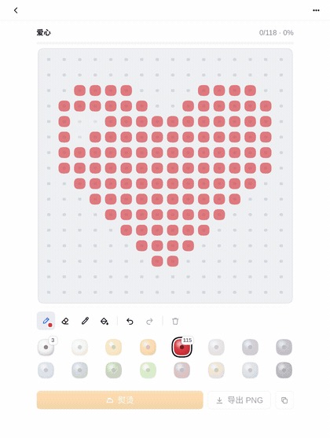
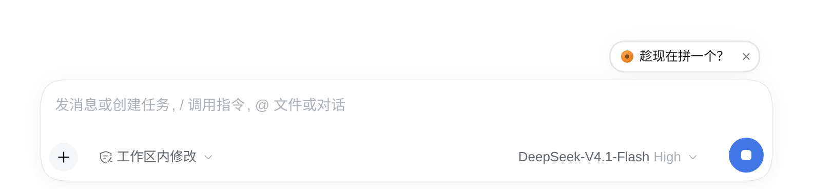
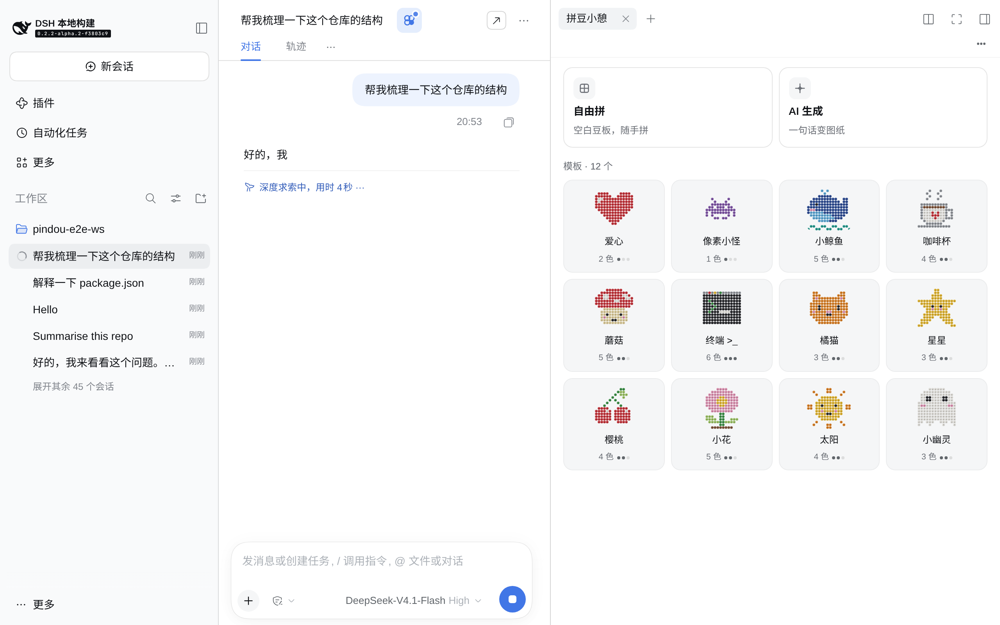
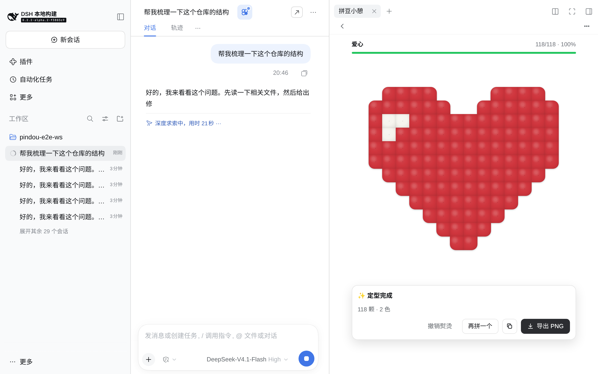
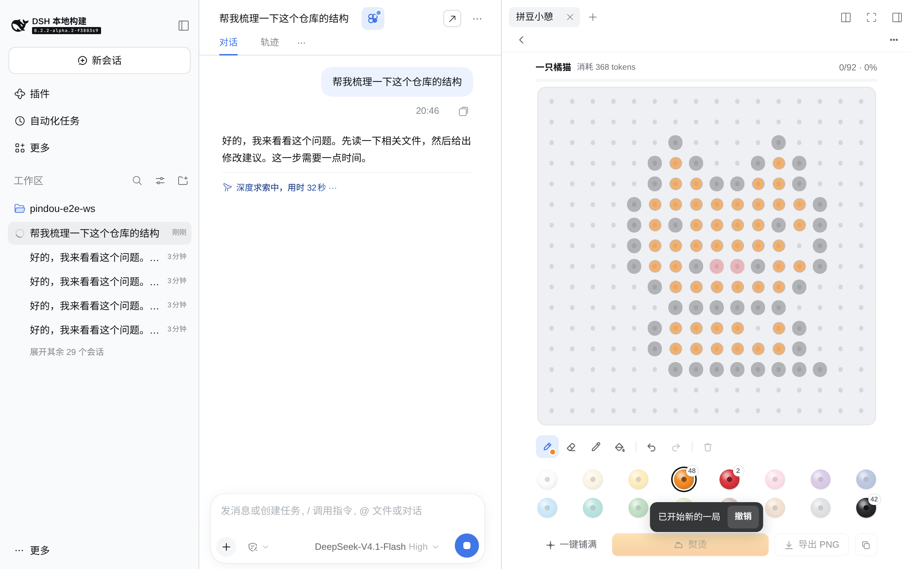
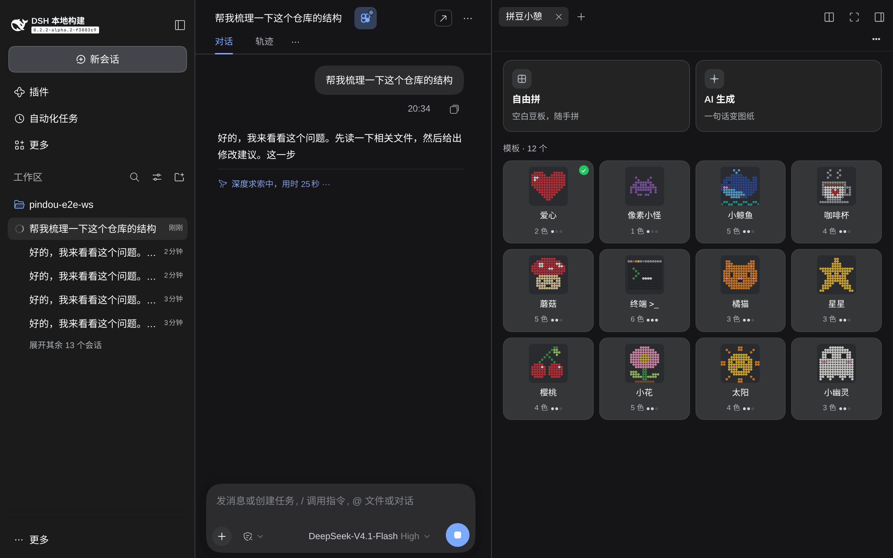
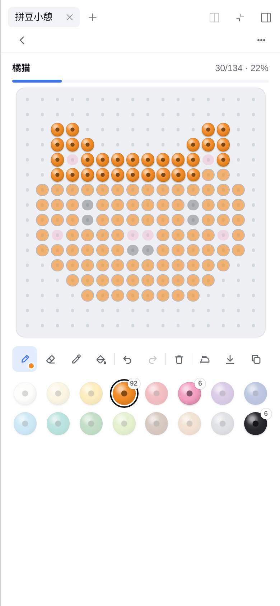

# 拼豆小憩 · Bead Break

**中文** · [English](./README.en.md)

模型在思考的时候，来拼几颗豆子。

拼豆小憩是 [DeepSeek Harness（DSH）](https://github.com/deepseek-ai/deepseek-harness) Web 端的插件：在右侧边栏打开一块像素拼豆板，照着模板拼、自由拼，或者用一句话让模型生成图纸，拼完「熨烫」定型，导出 PNG。

<p align="center">
  
</p>

| 模型忙时的提示 | 模板 | 熨烫完成 |
| --- | --- | --- |
|  |  |  |
| **AI 生成** | **深色** | **手机宽度（390px）** |
|  |  |  |

## 安装

```bash
npx @deepseek-ai/dsh plugin --profile web add github:Teloi/dsh-pindou
```

然后重启 `dsh --profile web`。不需要 `allowBuilds`：仓库里已经提交了构建好的 `lib/`，也没有任何安装脚本。

卸载：

```bash
npx @deepseek-ai/dsh plugin --profile web remove dsh-pindou
```

## 怎么玩

- **入口**：会话标题栏右侧的豆子按钮，或模型运行 3 秒后输入框上方出现的小胶囊「趁现在拼一个？」。胶囊每个会话最多出现两次，你开始打字、面板已打开或窗口太窄时不出现，可以在 ⋯ 菜单里关掉。
- **模板**：12 个模板，豆板上有淡色的引导豆，顶部显示完成度；拼完先问要不要「熨烫」，熨烫定型后撒彩豆庆祝。
- **工具**：画笔、取色、橡皮、填充、撤销/重做、清空（清空后 5 秒内可以撤回）。豆板支持 12 / 16 / 24 三种尺寸，16 种颜色。
- **导出**：导出 PNG，或者直接「复制图片」到剪贴板（浏览器不支持时这个按钮不显示）。
- **图片转图纸**（v0.2）：主页的「图片转图纸」卡，或者把图片拖进面板、在主页按 ⌘V / Ctrl+V 粘贴（只在焦点在面板里时拦截，不碰聊天输入框；不是图片的文件在主页会被忽略）。裁成正方形，选尺寸 12 / 16 / 24、颜色数（16 / 8 / 4）、抖动和去背景，预览满意后「开始拼」。支持 PNG、JPG、GIF、WebP、BMP；不支持 SVG；文件不超过 20 MB、边长不超过 8000 px（按文件头里声明的尺寸判断，超出的在解码前就拒绝）。
- **我的作品**（v0.2）：每次熨烫完成自动收进作品墙，最多 60 件，超出时删掉最旧的；取消熨烫会同时撤出。主页显示一行缩略图，「全部 ›」进入作品墙；单件可以导出 PNG、复制图片、「再拼一次」，删除不弹确认，5 秒内可以撤销（Delete 键同样）。
- **自动保存**：进度存在浏览器的 localStorage 里（键 `dsh-pindou:v1`），关掉面板再打开还在。作品墙单独存在键 `dsh-pindou:works` 里，每件不到 1 KB。
- **隐私**：图片只在本机处理，不会上传，不发网络请求，也不花 tokens；原图不保存、不落盘，只保存量化后的图纸编码。
- **按需加载**（v0.2）：图片转图纸和作品墙页是异步模块，第一次打开时才加载，首屏包不变大。DSH 太旧、不支持动态加载时，卡片显示「需要新版 DSH」并不可用；加载失败时显示「加载失败，点此重试」。这两种情况下拖进面板的图片都会被吞掉，不会变成聊天附件。
- **快捷键**：桌面端默认 ⌘⌥K / Ctrl+Alt+K 打开或收起面板，可以在设置的快捷键里改绑。Web 端没有默认键（Web 里这组键已经是 DSH 的「搜索会话」），需要的话在设置里自己绑。
- **键盘与读屏**：方向键移动光标，空格/回车放豆，Delete 擦除；豆板是带标签的 grid，每格会读出位置、颜色和引导色。
- **语言与主题**：跟随 DSH 的语言（中文优先，另有英文）和浅色/深色主题。
- **暂不支持**（计划在 v2）：豆板缩放（豆板会按面板大小自动调整格子）；AI 生成时逐行落豆（现在是整张图纸一次出现）。

## AI 生成图纸

一句话（例如「一只橘猫」）→ 一次模型调用 → 校验并修复图纸 → 落到豆板上，同时显示消耗的 tokens。相同的请求会命中本地缓存（最多 24 条），不再花 tokens。

模型按下面的顺序选：

1. **DSH 当前的默认模型**（和你聊天用的是同一个，无需额外配置）。
2. 如果 DSH 没有可用的模型路由，而环境变量里有 `DEEPSEEK_API_KEY`，直接调用 DeepSeek API（`deepseek-chat`）。
3. 都没有时，AI 页会提示「还没有可用的模型」，模板和自由拼不受影响。

检测只看凭据有没有配置，不会为此调用模型；账号登录等无法提前确认的情况会提示「首次生成会检测模型配置」。Key 失效时，第一次生成失败后会一直显示未配置，直到你点「重新检测」。DSH 没有给插件开放跳到「模型」设置的接口，「打开 DSH 设置」按钮只在能用设置快捷键打开时出现（打开的是设置首页），其他情况只给文字步骤。

密钥只在 DSH 的服务端进程里读取，不会发到浏览器。

<details>
<summary>可选配置</summary>

在 Web profile 的 `$DSH_HOME/profiles/web/cordis.patch.yml` 里，用同一个 id `pindou` 覆盖配置：

```yaml
- id: pindou
  config:
    provider: deepseek-official
    model: deepseek-v4-flash
    maxTokens: 1024
```

可用的键如下，全部可选；未知键或非法值会让插件加载失败并给出原因：

| 键 | 默认值 | 说明 |
| --- | --- | --- |
| `provider` + `model` | — | 固定使用某个 DSH 模型路由，两个必须一起给 |
| `apiKeyEnv` | `DEEPSEEK_API_KEY` | 直连兜底读取的环境变量名 |
| `baseUrl` | `https://api.deepseek.com` | 直连兜底的地址（只允许 https，测试时可用 http://localhost） |
| `fallbackModel` | `deepseek-chat` | 直连兜底用的模型 |
| `maxTokens` | `1024` | 每次生成的输出上限 |
| `timeoutMs` | `30000` | 单次生成超时 |
| `minIntervalMs` | `1500` | 两次生成的最短间隔 |

</details>

## 开发

```bash
pnpm install
pnpm run check      # lint + typecheck + 测试 + 构建 + bundle 形状检查
pnpm run e2e        # 从源码启动 DSH Web，用 Playwright 跑一遍，截图写进 $TMPDIR/pindou-e2e-out（加 -- --update-assets 才会刷新 docs/assets）
```

代码分三层：`src/core`（纯逻辑：豆板、模板、图纸校验修复、缓存，无 DOM）、`src/client`（React 界面与 DSH 客户端胶水）、`src/host`（DSH 服务端：模型调用）。DSH 的界面约束和设计决定记在 [docs/dsh-ui-constraints.md](docs/dsh-ui-constraints.md)。

参与贡献请看 [CONTRIBUTING.md](CONTRIBUTING.md)，变更记录见 [CHANGELOG.md](CHANGELOG.md)。

## 许可

[MIT](LICENSE) © 2026 Teloi
